# 🧪 Taller MLflow — Experimentación, registro y servicio de modelos (Grupo 5)

Entorno de MLOps desplegado con **Docker Compose** en una máquina virtual. Los datos de
*Forest Cover Type* viven en **PostgreSQL** (sin procesar y procesados), **JupyterLab**
ejecuta 22 experimentos con distintos hiperparámetros registrados en **MLflow**, el mejor
modelo se registra en el **Model Registry** y un **API de inferencia con FastAPI** lo
sirve obteniéndolo **mediante MLflow**. MLflow guarda sus metadatos en su propia base de
datos PostgreSQL y los archivos de los modelos en **MinIO**.

---

## ⭐ Puntos clave

- **Resultado en la VM:** 581.012 filas en `raw` y en `processed` (0 descartadas),
  22 corridas registradas en MLflow y un Random Forest con **macro-F1 0,851**
  (accuracy 0,892) promovido a `@champion` y sirviendo predicciones (sección 12).
- **Dos instancias de PostgreSQL**, como pide el enunciado: una para los datos y otra
  dedicada a los metadatos de MLflow.
- **El API obtiene el modelo solo a través de MLflow.** No tiene credenciales de MinIO:
  el servidor MLflow recibe y entrega los archivos de los modelos (*proxied artifacts*).
- **Registro con alias, no con *stages*.** El API sirve `models:/covertype@champion`.
  El alias solo se mueve si el nuevo modelo le gana al campeón actual sobre las mismas
  filas de prueba.
- **Experimentos comparables:** muestra estratificada fija de 100.000 filas
  (`random_state=42`). La huella de las filas de prueba es idéntica en el portátil y en
  la VM, así que todos los modelos se evalúan sobre los mismos datos.
- **Reproducibilidad:** MLflow, scikit-learn, numpy, scipy, pandas, skops y cloudpickle
  están fijados a las mismas versiones en Jupyter y en el API (`uv.lock`; los 90
  paquetes compartidos coinciden). El API **se niega a arrancar** si el modelo se
  entrenó con otras versiones.
- **Nueve problemas reales encontrados y resueltos**, varios propios de MLflow 3
  (sección 13).

---

## 📑 Contenido

1. [Cumplimiento del enunciado](#1-cumplimiento-del-enunciado)
2. [Arquitectura](#2-arquitectura)
3. [Servicios y puertos](#3-servicios-y-puertos)
4. [Qué es MLflow y cómo se usa aquí](#4-qué-es-mlflow-y-cómo-se-usa-aquí)
5. [Datos: dos etapas en PostgreSQL](#5-datos-dos-etapas-en-postgresql)
6. [Experimentos en Jupyter](#6-experimentos-en-jupyter)
7. [Registro de modelos: campeón contra retador](#7-registro-de-modelos-campeón-contra-retador)
8. [API de inferencia](#8-api-de-inferencia)
9. [Reproducibilidad y versiones](#9-reproducibilidad-y-versiones)
10. [Despliegue en la VM paso a paso](#10-despliegue-en-la-vm-paso-a-paso)
11. [Cómo leer la interfaz de MLflow](#11-cómo-leer-la-interfaz-de-mlflow)
12. [Resultados y evidencias](#12-resultados-y-evidencias)
13. [Problemas encontrados y resueltos](#13-problemas-encontrados-y-resueltos)
14. [Estructura del repositorio](#14-estructura-del-repositorio)

---

## 1. Cumplimiento del enunciado

| Requisito | Cómo se cumple | Dónde |
|---|---|---|
| Base de datos dedicada a la metadata de MLflow | Servicio `postgres-mlflow` (PostgreSQL 15), usado como *backend store* | [docker-compose.yml](docker-compose.yml), [sección 3](#3-servicios-y-puertos) |
| Instancia de MLflow | Servidor MLflow 3.16.1 con imagen propia | [mlflow/Dockerfile](mlflow/Dockerfile), [sección 4](#4-qué-es-mlflow-y-cómo-se-usa-aquí) |
| MinIO dedicado a MLflow | Servicio `minio` + bucket `mlflow`, usado como *artifact store* | [docker-compose.yml](docker-compose.yml) |
| Instancia de JupyterLab | Servicio `jupyter` con el notebook de experimentos | [notebooks/covertype_experiments.ipynb](notebooks/covertype_experiments.ipynb) |
| Al menos 20 ejecuciones con variación de hiperparámetros, todo en MLflow | 22 corridas: 9 Random Forest, 9 HistGradientBoosting, 4 regresión logística | [sección 6](#6-experimentos-en-jupyter) |
| Datos en una base de datos y datos procesados en base de datos (distinta a la de MLflow) | `postgres-data` con esquemas `raw` y `processed` | [sección 5](#5-datos-dos-etapas-en-postgresql) |
| Modelos registrados en MLflow | Modelo registrado `covertype`, versiones y alias `@champion` | [sección 7](#7-registro-de-modelos-campeón-contra-retador) |
| API de inferencia que toma el modelo **mediante** MLflow | Carga `models:/covertype@champion` desde el servidor MLflow, sin acceso directo a MinIO | [api/main.py](api/main.py), [sección 8](#8-api-de-inferencia) |

---

## 2. Arquitectura

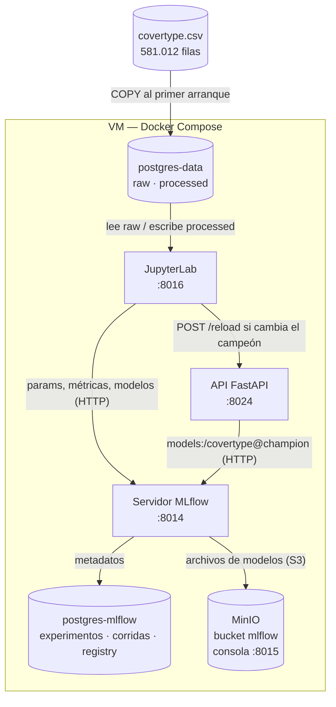

Solo el servidor MLflow habla con MinIO. Jupyter y el API conocen únicamente
`MLFLOW_TRACKING_URI=http://mlflow:5000`.

---

## 3. Servicios y puertos

La VM solo permite puertos del host entre 8000 y 8025.

| Servicio | Imagen | Función | Puerto en el host |
|---|---|---|---|
| `postgres-data` | `postgres:15` | Datos: esquemas `raw` y `processed` | interno |
| `postgres-mlflow` | `postgres:15` | Metadatos de MLflow | interno |
| `minio` | `cgr.dev/chainguard/minio` (fijada por digest) | Archivos de los modelos | **8015** (consola) |
| `minio-init` | misma imagen | Crea el bucket `mlflow` y termina | — |
| `mlflow` | propia (`mlflow/`) | Tracking server + Model Registry | **8014** |
| `jupyter` | propia (`jupyter/`) | Experimentos | **8016** |
| `api` | propia (`api/`) | Inferencia | **8024** |

El API S3 de MinIO (puerto 9000) no se expone: solo lo usa el servidor MLflow dentro de
la red de Docker.

**Orden de arranque** (`depends_on` con *healthchecks*):

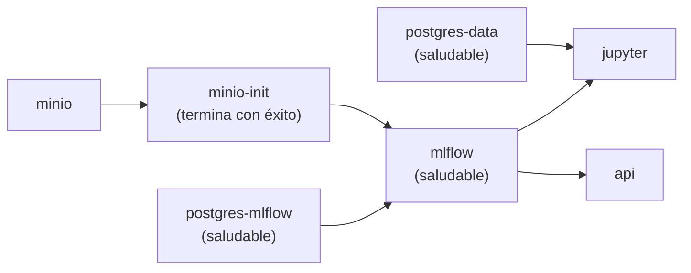

---

## 4. Qué es MLflow y cómo se usa aquí

MLflow es una bitácora de experimentos y un catálogo de modelos.

| Concepto | Qué es | En este taller |
|---|---|---|
| **Experiment** | Carpeta de intentos | `covertype_tuning` |
| **Run** | Un entrenamiento: parámetros, métricas, etiquetas y archivos | 1 corrida padre (*sweep*) + 22 corridas hijas por ejecución del notebook |
| **Logged model** | Modelo guardado en formato MLflow: archivo del modelo, versiones de librerías y firma de entrada | `model.skops`, `requirements.txt`, `MLmodel` en cada corrida hija |
| **Model Registry** | Catálogo de modelos con nombre y versiones numeradas | Modelo `covertype`, versiones 1, 2, … |
| **Alias** | Etiqueta movible que apunta a una versión | `@champion` → versión que sirve el API |
| **pyfunc** | Interfaz única para cargar y predecir con cualquier modelo | El API usa `mlflow.pyfunc.load_model(...)` |

### Dónde guarda MLflow cada cosa

- **Backend store** (`postgres-mlflow`): experimentos, corridas, parámetros, métricas,
  modelos registrados y alias.
- **Artifact store** (MinIO, bucket `mlflow`): los archivos de cada modelo.

### Artefactos a través del servidor (*proxied artifacts*)

El ejemplo del profesor usa `--default-artifact-root s3://...`. Con esa opción cada
cliente sube los archivos directamente a MinIO, así que Jupyter y el API necesitan las
credenciales de MinIO. Aquí se usa `--artifacts-destination s3://mlflow --serve-artifacts`:

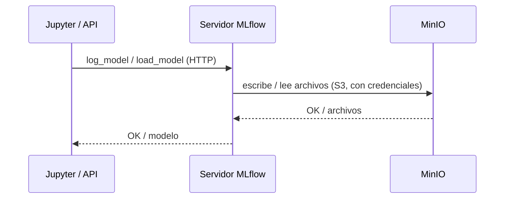

Ventajas: las credenciales de MinIO están en un solo servicio, el puerto S3 no se expone
y el API obtiene el modelo estrictamente "mediante MLflow". Se comprobó con un cliente
sin ninguna variable de MinIO: registró, etiquetó y cargó un modelo solo a través del
servidor.

---

## 5. Datos: dos etapas en PostgreSQL

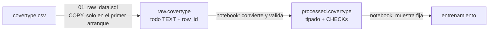

- **`raw.covertype`**: el CSV tal cual, todos los valores como `TEXT` (convertir tipos ya
  es procesar). `row_id BIGSERIAL` conserva el orden del archivo para que la muestra sea
  siempre la misma. Lo carga PostgreSQL al primer arranque con
  [`postgres/init/01_raw_data.sql`](postgres/init/01_raw_data.sql). Si falta el CSV, el
  contenedor no arranca, en vez de quedar una base de datos vacía.
- **`processed.covertype`**: lo escribe el notebook. Convierte a enteros y descarta filas
  no numéricas, no enteras, con categorías vacías, `aspect` fuera de 0–360 o
  `hillshade` fuera de 0–255. Las mismas reglas están como `CHECK` en la tabla.
  `TRUNCATE` + inserción en una sola transacción: re-ejecutar el notebook reemplaza la
  tabla en vez de duplicarla. La inserción usa `COPY`, mucho más rápido que `INSERT`
  fila por fila para 581.012 filas.
- **El entrenamiento lee solo de `processed`.**

---

## 6. Experimentos en Jupyter

El notebook [`covertype_experiments.ipynb`](notebooks/covertype_experiments.ipynb) hace
todo el flujo en nueve secciones: datos crudos → procesamiento → escritura → muestra →
candidatos → experimentos → registro → aviso al API → versiones registradas.

### Muestra fija

581.012 filas × 22 corridas sería lento en la VM. Se toma una **muestra estratificada de
100.000 filas** y se divide **80/20**, ambas con `random_state=42`. Estratificada: cada
clase conserva su proporción (la clase 3 es solo el 0,5%). Fija: siempre las mismas
filas, así que cualquier diferencia entre corridas viene de los hiperparámetros y no de
los datos. La huella MD5 de los `row_id` de prueba se registra en MLflow como evidencia.

### Los 22 candidatos

Cada candidato es un `Pipeline` de scikit-learn completo: `OneHotEncoder` para
`wilderness_area` y `soil_type`, `StandardScaler` para las 10 columnas numéricas, y el
clasificador. Así el modelo recibe valores crudos como `"Rawah"` y `"C7745"`. Todos usan
`class_weight="balanced"` por el desbalance de clases.

| Modelo | Hiperparámetros | Corridas |
|---|---|---|
| Random Forest | `n_estimators` [50, 100, 200] × `max_depth` [10, 20, None] | 9 |
| HistGradientBoosting | `learning_rate` [0,05, 0,1, 0,2] × `max_leaf_nodes` [15, 31, 63] | 9 |
| Regresión logística | `C` [0,01, 0,1, 1, 10] | 4 |

### Una corrida de MLflow por candidato

Se usa un ciclo con `mlflow.start_run()` por combinación, agrupadas bajo una corrida
padre `sweep_<fecha>`. Cada corrida hija registra sus hiperparámetros, sus métricas de
prueba (macro-F1, accuracy, F1 por clase), el tiempo de entrenamiento y **el modelo**
con un ejemplo de entrada, del que MLflow infiere la firma.

No se usa `GridSearchCV` + `mlflow.autolog()` como en el ejemplo del profesor por dos
razones:

- `autolog` tiene `max_tuning_runs=5` por defecto: solo crea corridas para las **5 mejores**
  combinaciones y el resto queda escondido en un CSV dentro de la corrida padre.
- `GridSearchCV` hace validación cruzada: entrena cada combinación 5 veces.

Con el ciclo, cada combinación es exactamente una corrida visible con su propio modelo.

---

## 7. Registro de modelos: campeón contra retador

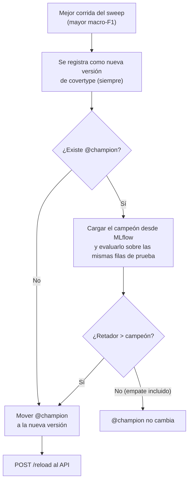

- **Cada ejecución del notebook registra una versión nueva**, gane o no, para conservar
  el historial. Las etiquetas `macro_f1`, `promoted` y `sweep` de cada versión dicen qué
  pasó.
- **Aliases, no *stages*.** El ejemplo del profesor carga `models:/modelo1/production`,
  que usa los *stages* (`Staging`/`Production`), obsoletos desde MLflow 2.9. Los alias
  los reemplazan.
- **Probado:** en la VM, la primera ejecución registró v1 y la promovió ("no champion
  yet"). En la prueba local, una segunda ejecución registró v2 y **no** la promovió: `challenger v2 0.8510 vs champion v1
  0.8510`. El empate confirma que las filas de prueba son las mismas.

---

## 8. API de inferencia

[`api/main.py`](api/main.py) sirve la versión que tiene el alias `@champion`.

| Método | Ruta | Respuesta |
|---|---|---|
| GET | `/` | Servicio y versión servida |
| GET | `/health` | `status`, `model_loaded`, `mlflow_reachable` |
| GET | `/model` | Nombre, alias, versión, `run_id`, nombre de la corrida, métricas y parámetros. 404 si no hay modelo |
| POST | `/reload` | Vuelve a leer `@champion`. 409 si las versiones no coinciden (mantiene el modelo actual), 404 si no hay campeón, 503 si MLflow no responde |
| POST | `/predict` | `cover_type`, `probabilities`, `model_name`, `model_version`, `run_id`. 503 si no hay modelo |

Ejemplo real en la VM (primera fila del CSV, clase real 4):

```json
{
  "cover_type": 4,
  "probabilities": {"0": 0.005, "1": 0.265, "2": 0, "3": 0, "4": 0.73, "5": 0, "6": 0},
  "model_name": "covertype",
  "model_version": 1,
  "run_id": "4dd61c17d9554cc4baa5f21f19ef1e8a"
}
```

### Decisiones del API

- **Carga la versión resuelta, no el alias.** Convierte `@champion` en un número (por
  ejemplo v1) y carga `models:/covertype/1`. Si el alias se mueve durante la carga, el
  modelo y la versión reportada siguen coincidiendo.
- **Recarga explícita.** El modelo se carga al arrancar y con `POST /reload`, que el
  notebook llama solo cuando `@champion` cambió. No hay sondeo en segundo plano.
- **Arranque tolerante, pero no con versiones distintas.** Sin campeón todavía, o con
  MLflow inaccesible, el API arranca y `/predict` responde 503. Si el modelo se entrenó con
  otras versiones de las librerías, el API **no arranca**.
- **Dos capas de validación.** Pydantic valida rangos (`aspect` 0–360, `hillshade`
  0–255) y responde 422. La firma que MLflow guardó con el modelo rechaza columnas o tipos
  que el modelo no conoce.
- **Probabilidades:** `pyfunc.predict()` devuelve solo la clase; `predict_proba` se toma
  del `Pipeline` de scikit-learn con `get_raw_model()`.

### Casos de error probados

Probados en el entorno local (mismas imágenes y versiones que en la VM):

| Situación | Resultado |
|---|---|
| `aspect: 400` | 422 (Pydantic) |
| Una columna que el modelo no conoce | Rechazada por la firma de MLflow |
| scikit-learn con otra versión al arrancar | El API se niega a arrancar |
| Versión distinta en `/reload` | 409, sigue sirviendo el modelo actual |
| Sin `@champion` | Arranca; `/predict` 503, `/model` y `/reload` 404; funciona en cuanto existe el alias |
| `@champion` movido v1 → v2 → v1 | `/reload` lo sigue cada vez |

---

## 9. Reproducibilidad y versiones

- Las tres imágenes propias usan `python:3.11-slim` + `uv sync --frozen --no-cache`:
  instalan exactamente lo que dice `uv.lock` y fallan si el lock está desactualizado.
- **Versiones fijadas en Jupyter y en el API:** `mlflow==3.16.1`, `scikit-learn==1.9.1`,
  `numpy==2.4.6`, `scipy==1.17.1`, `pandas==3.0.6`, `skops==0.16.0`,
  `cloudpickle==3.1.2`. El API además fija `psutil==7.2.2`, que MLflow anota en los
  requisitos del modelo. Los 90 paquetes que comparten los dos `uv.lock` tienen la misma
  versión.
- **Por qué hace falta:** `mlflow.pyfunc.load_model` solo *advierte* si las versiones no
  coinciden y carga el modelo igual. Por eso el API lee el `requirements.txt` que MLflow
  guardó con el modelo y compara scikit-learn, numpy y skops con las instaladas.
- **skops en vez de pickle:** MLflow 3.16 guarda los modelos de scikit-learn con skops,
  un formato más seguro. skops rechaza la estructura interna de los árboles a menos que se
  marque como confiable. El notebook confía exactamente en el tipo que necesita cada
  familia (encontrado con `skops.io.get_untrusted_types`), porque los modelos los entrenamos
  nosotros.

---

## 10. Despliegue en la VM paso a paso

Todos los comandos se ejecutan en la VM desde `~/MLOps/Nivel_2/Taller_MLflow`.

**1. Preparar.** El CSV y `.env` no están en el repositorio.

```bash
scp covertype.csv estudiante@10.43.97.90:/home/estudiante/MLOps/Nivel_2/Taller_MLflow/data/   # desde el PC
cp .env.example .env
sed -i "s/^HOST_UID=.*/HOST_UID=$(id -u)/" .env
```

**2. Verificar el espacio.** Docker vive en `/var` (15 GB en esta VM). Las imágenes ocupan
unos 4 GB y cada ejecución del notebook guarda ~1,1 GB de modelos en MinIO.

```bash
df -h /var
```

**3. Construir una imagen a la vez y arrancar.**

```bash
sudo docker compose build mlflow
sudo docker compose build api
sudo docker compose build jupyter
sudo docker builder prune -af
sudo docker compose up -d
sudo docker compose ps -a
```

**4. Ejecutar el notebook.** Abrir `http://10.43.97.90:8016` (token en `.env`), abrir
`covertype_experiments.ipynb` y usar **Kernel › Restart Kernel and Run All Cells**.
Tarda unos 10 minutos en la VM.

**5. Revisar.** MLflow en `http://10.43.97.90:8014`, consola de MinIO en
`http://10.43.97.90:8015` y el API en `http://10.43.97.90:8024/docs`.

**Detener:** `sudo docker compose down` conserva los datos; `sudo docker compose down -v`
borra datos, corridas y modelos.

---

## 11. Cómo leer la interfaz de MLflow

- **Experiments › `covertype_tuning`**: cada ejecución del notebook es una corrida padre
  `sweep_<fecha>`. Al expandirla aparecen las **22 corridas hijas**.
- **La corrida padre no tiene artefactos** a propósito: solo agrupa y guarda los
  parámetros de la muestra y `best_macro_f1`. Los modelos están en las corridas hijas:
  su pestaña *Artifacts* muestra `MLmodel`, `model.skops` y `requirements.txt`.
- **Models › `covertype`**: las versiones registradas y el alias `@champion`.
- **Overview / Traces / Latency** están pensados para aplicaciones de IA generativa
  (trazas de llamadas a LLM). Con modelos clásicos aparecen vacíos.

---

## 12. Resultados y evidencias

### Resultados en la VM

| Métrica | Valor |
|---|---|
| Filas en `raw` / `processed` | 581.012 / 581.012 (0 descartadas) |
| Muestra de entrenamiento / prueba | 80.000 / 20.000 |
| Huella de las filas de prueba | `e71d85d0ba560ef19310fbd98ddddba9` (igual en el portátil) |
| Duración del sweep (22 corridas) | 9,4 min |
| Modelos en MinIO | 1,6 GiB, 221 objetos |

| Familia | Mejor macro-F1 | Accuracy | Combinación |
|---|---|---|---|
| **Random Forest** | **0,851** | **0,892** | 200 árboles, sin límite de profundidad → `covertype` v1 `@champion` |
| HistGradientBoosting | 0,828 | 0,857 | `learning_rate` 0,2, 63 hojas |
| Regresión logística | 0,498 | 0,593 | `C` = 10 |

Los resultados son idénticos a los del portátil: la muestra fija y las versiones fijadas
hacen el experimento reproducible entre máquinas.

### Evidencias

**Servicios en marcha**

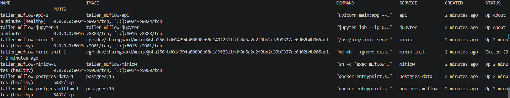

**API antes de entrenar:** sin modelo, MLflow accesible

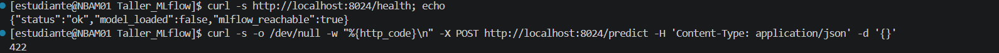

**Datos crudos** (`raw.covertype`)

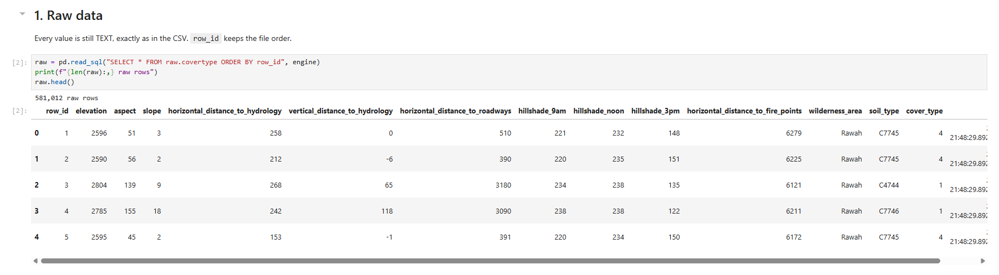

**Procesamiento y escritura en `processed.covertype`**

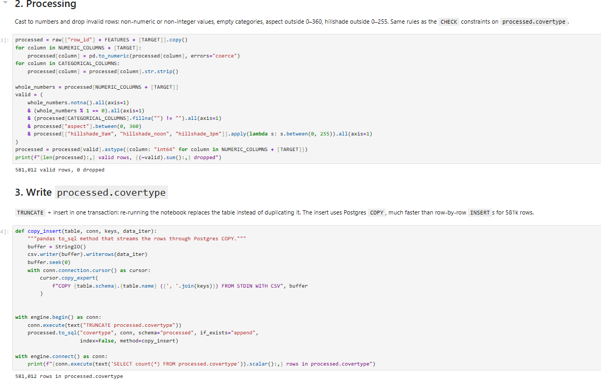

**Muestra estratificada:** las proporciones de cada clase se conservan

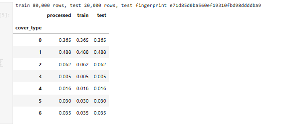

**Ranking de las 22 corridas**

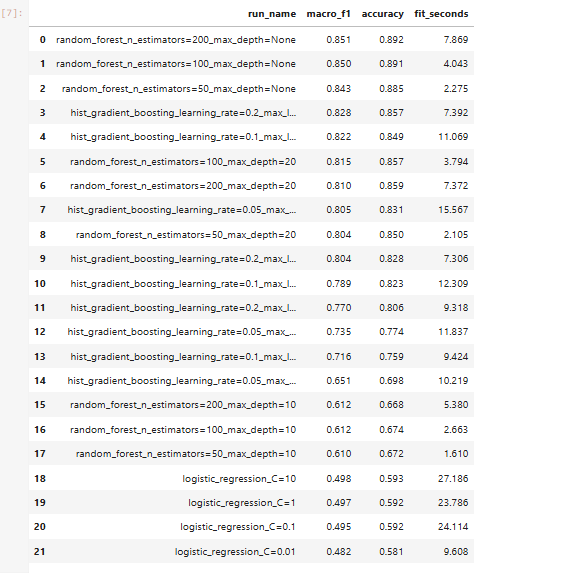

**Registro y promoción a `@champion`**

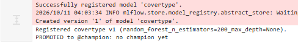

**Aviso al API (`/reload` 200) y versiones registradas**

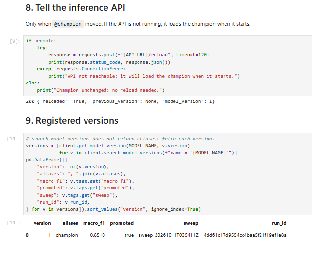

**Las dos etapas en PostgreSQL**

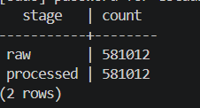

**Corrida padre en MLflow:** parámetros de la muestra, mejor métrica y corridas hijas

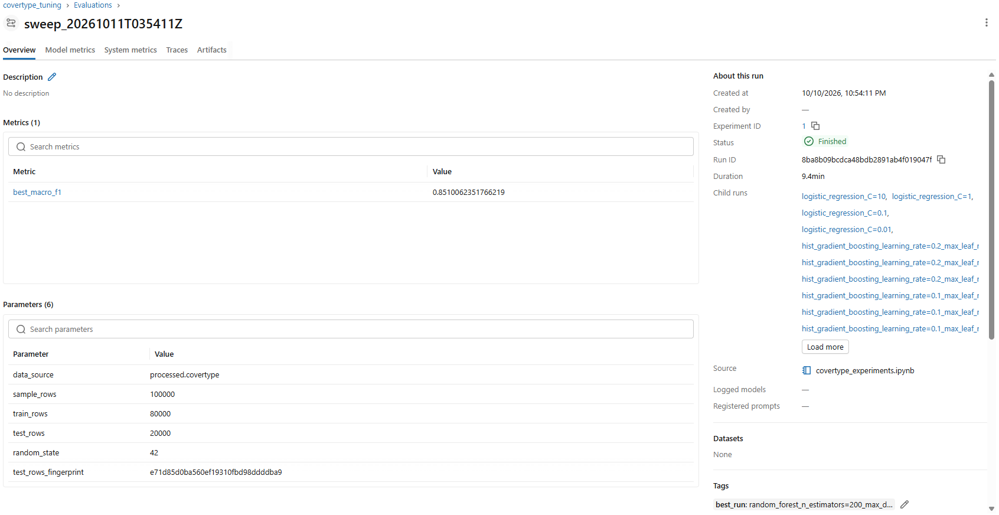

**Archivos de los modelos en MinIO**, escritos por el servidor MLflow

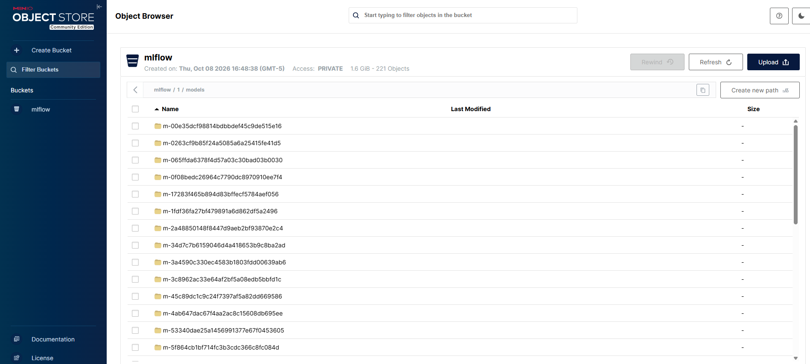

**`GET /model`:** versión, corrida y métricas que sirve el API

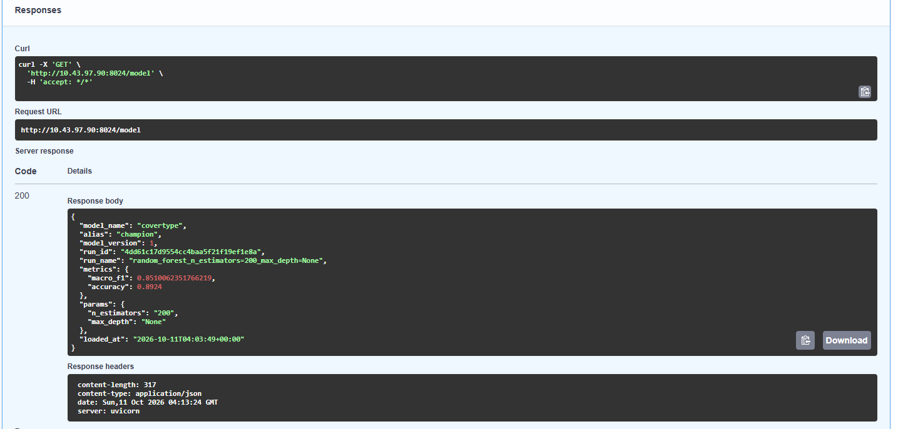

**`POST /predict`:** clase 4, correcta para la primera fila del CSV

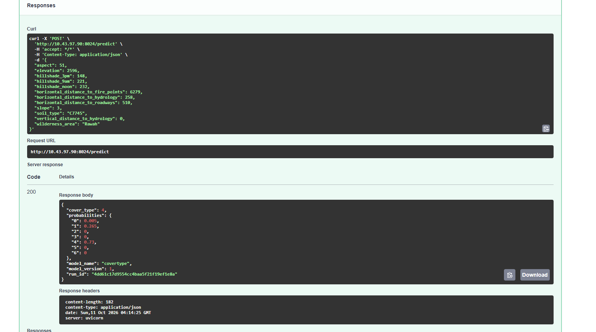

---

## 13. Problemas encontrados y resueltos

| Problema | Causa | Solución |
|---|---|---|
| Jupyter y el API recibían 403 "Invalid Host header - possible DNS rebinding attack detected" | MLflow 3 solo acepta por defecto `localhost` e IPs privadas; `mlflow:5000` (nombre del servicio) no estaba incluido | `--allowed-hosts` con el nombre del servicio, localhost y rangos privados |
| En la VM, la interfaz de MLflow registraba "Blocked cross-origin request" | Por defecto MLflow solo acepta peticiones de páginas servidas desde localhost | `--cors-allowed-origins` con `http://10.43.97.90:8014`. Un origen desconocido sigue recibiendo 403 |
| `log_model` fallaba con "untrusted types" | MLflow 3.16 guarda con skops, que no confía en la estructura interna de los árboles | `skops_trusted_types` con el tipo exacto de cada familia |
| Las 9 corridas de HistGradientBoosting daban solo 4 resultados distintos | Con más de 10.000 filas scikit-learn activa *early stopping* y `max_iter` 100/200/300 no cambiaba nada | Variar `max_leaf_nodes` en vez de `max_iter`: 9 resultados distintos |
| La tabla de versiones no mostraba el alias | `search_model_versions` no devuelve alias | Consultar cada versión con `get_model_version` |
| Advertencia de dependencias al cargar el modelo | MLflow anota `psutil` en los requisitos del modelo y el API no lo tenía | Fijar `psutil==7.2.2` en el API |
| "No space left on device" al construir en la VM | `/var` (15 GB) lleno: la caché de descargas de uv quedaba dentro de cada imagen | `uv sync --no-cache` (imágenes ~2× más pequeñas) y construir una imagen a la vez |
| El servidor MLflow respondía 500 durante los experimentos | De nuevo `/var` lleno: MinIO no podía guardar los modelos | Liberar espacio en Docker; verificar `df -h /var` antes de entrenar |
| Imágenes oficiales de MinIO no disponibles | `minio/minio` y `quay.io/minio/minio` ya no se publican | Imagen de Chainguard fijada por digest |

El ejemplo del profesor tenía además estos puntos, corregidos aquí: metadatos en SQLite
en vez de una base de datos dedicada, bucket `mlflows3` que nunca se crea, puertos fuera
del rango 8000–8025, *stages* obsoletos y una celda con `set_tracking_uri("http://minio:5000")`.

---

## 14. Estructura del repositorio

```text
Taller_MLflow/
├── docker-compose.yml          # los 7 servicios
├── .env.example                # plantilla de configuración (.env no se versiona)
├── data/                       # covertype.csv (no se versiona, 32 MB)
├── postgres/init/
│   └── 01_raw_data.sql         # esquemas raw/processed y carga del CSV
├── mlflow/                     # imagen del servidor MLflow (Dockerfile, pyproject, uv.lock)
├── jupyter/                    # imagen de JupyterLab (Dockerfile, pyproject, uv.lock)
├── notebooks/
│   └── covertype_experiments.ipynb
├── api/                        # API de inferencia (main.py, Dockerfile, pyproject, uv.lock)
└── images/                     # evidencias del despliegue en la VM
```
