# 🦗 Taller Locust — Capacidad de inferencia con 1 y 3 réplicas (Grupo 5)

Prueba de carga de un **API de inferencia con FastAPI** que carga su modelo desde
**MLflow**. La imagen del API está publicada en **Docker Hub** y corre en una VM detrás de
**Nginx** como balanceador, con cada réplica limitada a **1 CPU y 1 GB**. **Locust** genera
la carga desde otra máquina (el PC personal, por VPN). Se determina la concurrencia máxima
sostenible con una y con tres réplicas y se analiza qué recurso se satura primero.

---

## ⭐ Puntos clave

- **1 réplica:** máximo **45 usuarios concurrentes, 23,1 RPS** (p95 470 ms, 0,02% fallos).
- **3 réplicas:** máximo **130 usuarios concurrentes, 68,8 RPS** (p95 350 ms, 0% fallos).
- **Escalamiento casi lineal:** **×2,89 en usuarios (+189%) y ×2,98 en RPS (+198%)**.
- **El primer recurso en saturarse es la CPU de cada réplica.** La memoria se mantiene
  plana en ~500–530 MiB (≈52% del límite) en todos los niveles.
- **Otros cuellos de botella descartados con evidencia:** sin *steal time* en la VM
  (`vmstat`), *throttling* de CPU leve (1,9% de los periodos), Nginx ≤2% de CPU, MLflow,
  Postgres y MinIO fuera del camino de cada petición, y el generador nunca por encima de 90%.
- **El mejor modelo no cabe en 1 GB.** El campeón del Taller MLflow (Random Forest de 200
  árboles) muere por falta de memoria al cargarse. Se sirve el Random Forest de 50 árboles
  (macro-F1 0,843 contra 0,851), elegido después de medir memoria y latencia bajo el
  límite real.
- **Después de la saturación el rendimiento baja.** Con 3 réplicas: 140 usuarios → 70,2 RPS,
  150 → 60,7, 200 → 57,3. Por eso hubo que refinar los niveles alrededor del punto de quiebre.

---

## 📑 Contenido

1. [Cumplimiento del enunciado](#1-cumplimiento-del-enunciado)
2. [Arquitectura: dos máquinas](#2-arquitectura-dos-máquinas)
3. [Las herramientas](#3-las-herramientas)
4. [Imagen de inferencia en Docker Hub](#4-imagen-de-inferencia-en-docker-hub)
5. [Qué modelo se sirve y por qué](#5-qué-modelo-se-sirve-y-por-qué)
6. [Stack en la VM](#6-stack-en-la-vm)
7. [Diseño de la prueba](#7-diseño-de-la-prueba)
8. [Cómo se mide](#8-cómo-se-mide)
9. [Cómo reproducir](#9-cómo-reproducir)
10. [Resultados](#10-resultados)
11. [Respuestas a las preguntas del taller](#11-respuestas-a-las-preguntas-del-taller)
12. [Problemas encontrados](#12-problemas-encontrados)
13. [Evidencias](#13-evidencias)
14. [Estructura del repositorio](#14-estructura-del-repositorio)

---

## 1. Cumplimiento del enunciado

| # | Requisito | Cómo se cumple | Dónde |
|---|---|---|---|
| 1 | Imagen con un API FastAPI que infiere con un modelo cargado desde MLflow | API que carga `models:/covertype@loadtest` desde el servidor MLflow | [api/](api/), [sección 4](#4-imagen-de-inferencia-en-docker-hub) |
| 2 | Publicar la imagen en Docker Hub | `sebas10acosta/locust-covertype-api:1.0` | [sección 4](#4-imagen-de-inferencia-en-docker-hub) |
| 3 | `docker-compose.yaml` que ejecute la imagen publicada | El servicio `api` usa la imagen de Docker Hub, no un `build` | [docker-compose.yaml](docker-compose.yaml) |
| 4 | API + Nginx + servicios necesarios en una VM, sin Locust; 1 réplica con 1 CPU y 1 GB | VM `10.43.97.90`: Nginx, API, MLflow, Postgres, MinIO. `cpus: 1.0`, `mem_limit: 1g` | [sección 6](#6-stack-en-la-vm) |
| 5 | Locust desde otra máquina | PC personal por VPN, Locust en Docker | [locust/](locust/), [sección 2](#2-arquitectura-dos-máquinas) |
| 6 | Aumentar usuarios y hallar el máximo de 1 réplica | 10 niveles, de 1 a 200 usuarios | [sección 10](#10-resultados) |
| 7 | Repetir con 3 réplicas sin cambiar locustfile, tasa de aparición, duración ni criterio | `--scale api=3`; mismos parámetros | [sección 10](#10-resultados) |
| 8 | Comparar capacidad, RPS y tiempos | Tabla comparativa y respuestas | [sección 11](#11-respuestas-a-las-preguntas-del-taller) |

---

## 2. Arquitectura: dos máquinas

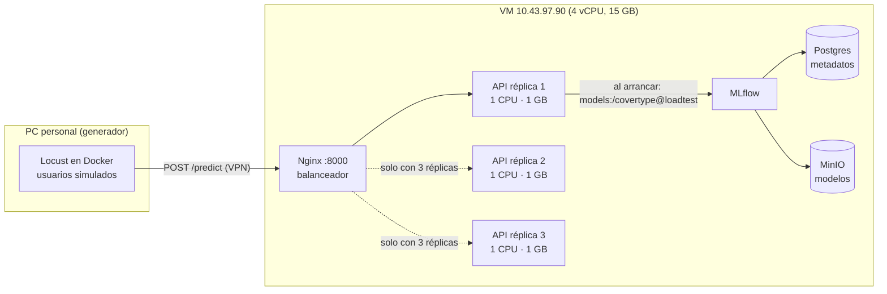

- **Locust nunca corre en la VM.** Si compartiera la CPU con el API, no se sabría si el
  límite es del API o del generador.
- **Nginx es la única entrada.** Las réplicas no publican puertos: tres contenedores no
  pueden publicar el mismo puerto del host.
- **MLflow solo participa al arrancar.** Cada réplica descarga el modelo una vez y luego
  predice desde memoria. MLflow, Postgres y MinIO no intervienen en cada petición.

---

## 3. Las herramientas

| Herramienta | Qué es | Conceptos usados aquí |
|---|---|---|
| **Locust** | Generador de carga: un archivo de Python describe lo que hace un usuario y Locust ejecuta cientos a la vez | **Usuarios**: simulados y activos al mismo tiempo. **Spawn rate**: cuántos usuarios nuevos por segundo hasta llegar al total. **`wait_time`**: pausa entre peticiones de un mismo usuario, por eso usuarios ≠ RPS. **p95**: el 95% de las peticiones responde en ese tiempo o menos. **Headless + CSV**: sin interfaz web y con resultados en archivos |
| **Nginx** | Proxy inverso y balanceador de carga | Una dirección fija (`:8000`) que reparte peticiones entre las réplicas, que descubre con el DNS interno de Docker |
| **Límites de Docker** | `cpus` y `mem_limit` por contenedor | Se aplican **a cada réplica**: 3 réplicas pueden usar hasta 3 CPU y 3 GB. Superar la memoria mata el contenedor (OOM) |
| **`docker stats`** | CPU y memoria de cada contenedor en vivo | Evidencia de qué recurso se satura |
| **Docker Hub** | Registro público de imágenes | La VM descarga la imagen publicada, no la construye |

### Cómo leer el p95

Si Locust envió 1.000 peticiones y se ordenan de la más rápida a la más lenta, el p95 es el
tiempo de la petición número 950: el 95% respondió en ese tiempo o menos. Se usa en vez del
promedio porque el promedio esconde a los usuarios que esperan mucho.

---

## 4. Imagen de inferencia en Docker Hub

- **Código:** copia del API del [Taller MLflow](../../Nivel_2/Taller_MLflow/) en
  [`api/`](api/). Carga `models:/<MODEL_NAME>@<MODEL_ALIAS>` desde el servidor MLflow al
  arrancar, con dependencias fijadas en `uv.lock` y un chequeo de versiones de las librerías.
- **La imagen no contiene el modelo ni credenciales.** Todo llega por variables de entorno:
  `MLFLOW_TRACKING_URI`, `MODEL_NAME` y `MODEL_ALIAS`.
- **Se construye y publica desde el PC; la VM solo la descarga:**

```bash
docker build -t sebas10acosta/locust-covertype-api:1.0 api/
docker login -u sebas10acosta
docker push sebas10acosta/locust-covertype-api:1.0
```

- **Etiqueta explícita `1.0`**, no `latest`: la VM ejecuta exactamente lo que se probó.
  1,09 GB descomprimida, 239,6 MB en Docker Hub.

---

## 5. Qué modelo se sirve y por qué

El campeón del Taller MLflow es un Random Forest de 200 árboles sin límite de profundidad
(macro-F1 0,851). Su archivo pesa **372 MB**. Bajo el límite del taller **muere por falta de
memoria mientras carga** (OOMKilled, código 137).

Se midió cada candidato en su propio contenedor con exactamente 1 CPU y 1 GB:

| Modelo | macro-F1 | Pico de RAM | Una predicción (mediana / p95) | ¿Cabe en 1 GB? |
|---|---|---|---|---|
| RF 200 árboles, sin límite (`@champion`) | 0,851 | — | — | ❌ muere al cargar |
| RF 100 árboles, sin límite | 0,850 | 830 MB | 15 / 25 ms | ⚠️ con poco margen |
| **RF 50 árboles, sin límite** | **0,843** | **553 MB** | **11 / 24 ms** | ✅ **elegido** |
| RF 100 árboles, profundidad 20 | 0,815 | 606 MB | 15 / 18 ms | ✅ |
| HistGB, lr 0,2, 63 hojas | 0,828 | 282 MB | 10 / 12 ms | ✅ |

**Se eligió el RF de 50 árboles:** pierde solo 0,008 de macro-F1 y usa la mitad de la
memoria permitida, lo que deja margen para el API y las peticiones bajo carga. El de 100
árboles cabe, pero con ~170 MB de margen un pico bajo carga lo mataría y se mediría la
caída en vez de la capacidad.

**Sin cambiar código:** el script
[`scripts/register_loadtest_model.py`](scripts/register_loadtest_model.py) registra esa
corrida como una versión de `covertype` y le pone el alias **`@loadtest`**. El API lo sirve
con `MODEL_ALIAS=loadtest`. El `@champion` del Taller MLflow no se toca. El script puede
ejecutarse varias veces: si la versión ya existe, la reutiliza.

> El tamaño del modelo es una restricción de operación, no solo de precisión: el modelo
> más preciso no es desplegable con los recursos asignados.

---

## 6. Stack en la VM

[`docker-compose.yaml`](docker-compose.yaml):

| Servicio | Imagen | Función | Puerto en el host |
|---|---|---|---|
| `api` | `sebas10acosta/locust-covertype-api:1.0` | Inferencia; `--scale api=1` o `3` | interno (8024) |
| `proxy` | `nginx:1.27.5-alpine` | Balanceador, única entrada | **8000** |
| `mlflow` | la del Taller MLflow | Tracking server + Model Registry | 8014 |
| `postgres-mlflow` | `postgres:15` | Metadatos de MLflow | interno |
| `minio` | Chainguard (fijada por digest) | Archivos de los modelos | 8015 (consola) |
| `register-model` | la del API (perfil `setup`) | Pone el alias `@loadtest` y termina | — |

### Decisiones

- **Reutiliza los volúmenes del Taller MLflow** (declarados `external`): los modelos
  entrenados allí ya están registrados. Si los volúmenes no existen, compose falla en vez
  de arrancar un MLflow vacío. **Los dos stacks nunca corren a la vez**: dos Postgres sobre
  el mismo directorio de datos lo corrompen.
- **Sin swap:** `memswap_limit` = `mem_limit`. La VM tiene 4 GB de swap; sin esto una réplica
  podría usar 1 GB de RAM más swap y esconder la presión de memoria.
- **Sin reinicio automático:** una réplica que muere por memoria queda muerta y visible, en
  vez de volver a mitad de la prueba.
- **Nginx sin reintentos** (`proxy_next_upstream`): reenviar a otra réplica escondería
  fallos, que es justo lo que se mide. `worker_processes auto` para que el balanceador no
  sea el cuello de botella, y la cabecera `X-Upstream-Addr` como evidencia de qué réplica
  respondió.
- **Solo lo necesario corre durante la prueba:** con 3 réplicas se usan 3 de los 4 núcleos,
  así que Jupyter y la base de datos de datos del Taller MLflow quedan apagados.

**Verificado localmente:** 30 peticiones se reparten 10/10/10 entre 3 réplicas, y Nginx
detecta réplicas nuevas sin reiniciarse.

---

## 7. Diseño de la prueba

### Criterio de capacidad

> Una configuración **soporta** un nivel si mantiene **menos de 1% de fallos** y un **p95
> menor a 500 ms** durante **2 minutos estables**.

Una predicción sin carga tarda ~10–25 ms. Un p95 por encima de 500 ms significa que las
peticiones esperan en cola: eso es saturación. La **capacidad máxima sostenible** es el
último nivel que cumple el criterio.

### Lo que hace cada usuario

[`locust/locustfile.py`](locust/locustfile.py):

- **Envía una fila real al azar** de [`payloads.json`](locust/payloads.json): 100 filas de
  `covertype.csv` tomadas con semilla fija, que conservan el desbalance real de clases. Un
  Random Forest recorre caminos distintos según la entrada, así que una sola fila fija
  mediría algo menos realista.
- **Espera entre 1 y 2,5 s** (`wait_time = between(1, 2.5)`), unos 0,57 RPS por usuario.
- **Éxito = HTTP 200 + JSON válido + `cover_type` entero de 0 a 6.** Cualquier otra respuesta
  se marca con `response.failure(...)` y su motivo queda en el reporte.

### Parámetros idénticos para 1 y 3 réplicas

| Parámetro | Valor |
|---|---|
| locustfile | el mismo archivo |
| Tasa de aparición | 10 usuarios/s en todos los niveles |
| Duración por nivel | 3 min |
| Ventana evaluada | desde que todos los usuarios están activos (`--reset-stats`) hasta el final: ≥ 2 min |
| Pausa entre niveles | 20 s, para que las colas se vacíen |

**Niveles:** primero una pasada gruesa y luego pasos menores alrededor del quiebre, como
pide el enunciado.

---

## 8. Cómo se mide

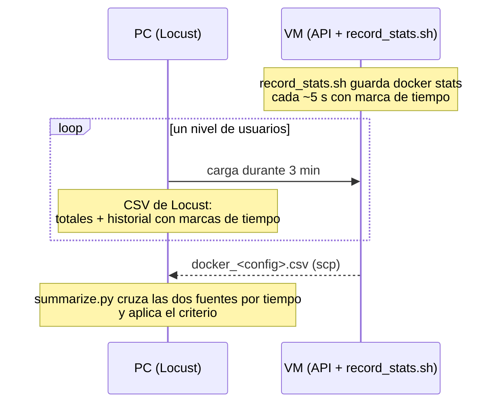

| Script | Dónde | Qué hace |
|---|---|---|
| [`scripts/run_levels.sh`](scripts/run_levels.sh) | PC | Una corrida *headless* por nivel, con un CSV por nivel. Avisa si Locust registró "CPU usage above 90%" |
| [`scripts/record_stats.sh`](scripts/record_stats.sh) | VM | Guarda `docker stats` de todos los contenedores con marca de tiempo Unix |
| [`scripts/summarize.py`](scripts/summarize.py) | PC | Toma la ventana estable de cada nivel del historial de Locust y promedia las muestras de `docker stats` dentro de ella: CPU por réplica, memoria máxima y CPU de Nginx. Marca PASS/FAIL |

**Línea base de red:** el nivel de 1 usuario mide el viaje sin colas. Su p50 de 62 ms es
~20 ms de predicción más ~40 ms de VPN y Nginx. Esos ~40 ms están en todos los p95.

**Generador vigilado:** Locust no superó el 90% de CPU en ningún nivel y el PC estuvo
cerca del 18% (captura `07`).

---

## 9. Cómo reproducir

**En la VM** (`~/MLOps/Nivel_3/Taller_Locust`). Antes debe haberse ejecutado el Taller
MLflow, que crea los volúmenes con los modelos, y su stack debe estar detenido con
`docker compose down` (sin `-v`).

```bash
cp .env.example .env
sudo docker compose pull api
sudo docker compose --profile setup run --rm register-model   # @loadtest -> RF 50
sudo docker compose up -d --scale api=1                        # o --scale api=3
sudo scripts/record_stats.sh rep1                              # en otra terminal; Ctrl+C al final
```

**En el PC** (Git Bash, `Nivel_3/Taller_Locust`, con Docker Desktop y la VPN activos):

```bash
scripts/run_levels.sh rep1 1 25 50 100 150 200    # pasada gruesa
scripts/run_levels.sh rep1 30 35 40 45            # alrededor del quiebre
scp estudiante@10.43.97.90:/home/estudiante/MLOps/Nivel_3/Taller_Locust/resultados/docker_rep1.csv resultados/
python scripts/summarize.py rep1_u
```

**Cambiar la cantidad de réplicas solo entre pruebas,** y esperar al menos 10 s antes del
siguiente nivel (sección 12).

---

## 10. Resultados

### 1 réplica (1 CPU, 1 GB)

| Usuarios | RPS | Peticiones | Fallos % | p50 ms | p95 ms | p99 ms | CPU API % | RAM API MiB | Cumple |
|---:|---:|---:|---:|---:|---:|---:|---:|---:|:---:|
| 1 | 0,6 | 101 | 0,00 | 62 | 73 | 91 | 1 | 502 | ✅ |
| 25 | 13,4 | 2.381 | 0,00 | 89 | 240 | 330 | 34 | 505 | ✅ |
| 30 | 16,2 | 2.862 | 0,00 | 87 | 220 | 330 | 47 | 518 | ✅ |
| 35 | 18,8 | 3.306 | 0,00 | 95 | 270 | 380 | 51 | 519 | ✅ |
| 40 | 21,0 | 3.715 | 0,00 | 120 | 380 | 540 | 60 | 519 | ✅ |
| **45** | **23,1** | **4.048** | **0,02** | **160** | **470** | **630** | **73** | **528** | ✅ **máximo** |
| 50 | 24,2 | 4.244 | 0,00 | 270 | 720 | 960 | 74 | 511 | ❌ |
| 100 | 26,2 | 4.455 | 0,13 | 2.100 | 2.600 | 2.900 | 88 | 526 | ❌ |
| 150 | 26,0 | 4.287 | 0,44 | 4.000 | 4.500 | 5.200 | 88 | 528 | ❌ |
| 200 | 25,1 | 4.017 | 0,52 | 6.200 | 6.900 | 7.500 | 89 | 530 | ❌ |

### 3 réplicas (1 CPU, 1 GB cada una)

| Usuarios | RPS | Peticiones | Fallos % | p50 ms | p95 ms | p99 ms | CPU API %/réplica | RAM API MiB | Cumple |
|---:|---:|---:|---:|---:|---:|---:|---:|---:|:---:|
| 1 | 0,5 | 94 | 0,00 | 62 | 88 | 160 | 1 | 531 | ✅ |
| 50 | 27,5 | 4.810 | 0,00 | 61 | 89 | 120 | 22 | 522 | ✅ |
| 100 | 53,8 | 9.251 | 0,00 | 69 | 190 | 320 | 47 | 522 | ✅ |
| 110 | 59,8 | 10.097 | 0,00 | 68 | 190 | 290 | 44 | 523 | ✅ |
| 120 | 63,9 | 10.722 | 0,01 | 84 | 380 | 710 | 58 | 524 | ✅ |
| **130** | **68,8** | **11.476** | **0,00** | **98** | **350** | **550** | **61** | **524** | ✅ **máximo** |
| 140 | 70,2 | 11.644 | 0,00 | 180 | 620 | 820 | 68 | 531 | ❌ |
| 150 | 60,7 | 10.011 | 0,04 | 440 | 2.100 | 2.900 | 62 | 532 | ❌ |
| 200 | 57,3 | 9.158 | 0,19 | 1.500 | 5.600 | 6.200 | 62 | 534 | ❌ |

CPU y RAM son promedios de las muestras de `docker stats` dentro de la ventana estable de
cada nivel. Nginx usó entre 0% y 2% de CPU en todos los niveles. Los CSV completos están en
[`resultados/`](resultados/).

### Comparación

| | 1 réplica | 3 réplicas | Cambio |
|---|---:|---:|---:|
| Concurrencia máxima sostenible | 45 usuarios | 130 usuarios | **+189% (×2,89)** |
| RPS en ese nivel | 23,1 | 68,8 | **+198% (×2,98)** |
| p95 en ese nivel | 470 ms | 350 ms | −120 ms |
| RPS máximo observado | 26,2 | 70,2 | ×2,68 |
| Memoria por réplica | 502–530 MiB | 522–534 MiB | sin cambio |

### Lo que muestran las tablas

- **Saturación clásica.** Con 1 réplica, más allá de ~50 usuarios el RPS deja de crecer
  (~26), y cada usuario adicional solo alarga la cola: el p95 pasa de 0,7 s a 2,6 s y a 6,9 s.
- **Después del quiebre el rendimiento cae.** Con 3 réplicas, 140 usuarios dan 70,2 RPS,
  pero 150 dan 60,7 y 200 dan 57,3: la cola, los cambios de contexto y el *throttling* le
  quitan tiempo al trabajo útil. Una pasada gruesa de 100 a 150 usuarios solo ve esta zona
  degradada y sugiere un techo de ~60 RPS que no es el real. Por eso fue necesario
  refinar.

---

## 11. Respuestas a las preguntas del taller

**¿Cuál es la concurrencia máxima sostenible y cuántos RPS procesa una réplica limitada a 1
CPU y 1 GB?**
**45 usuarios concurrentes y 23,1 RPS**, con p95 de 470 ms y 0,02% de fallos. Con 50 usuarios
el p95 sube a 720 ms y deja de cumplir. El techo de rendimiento de una réplica es ~26 RPS.

**¿Cuál es la concurrencia máxima sostenible y cuántos RPS procesan tres réplicas con esos
mismos límites por réplica?**
**130 usuarios concurrentes y 68,8 RPS**, con p95 de 350 ms y 0% de fallos. Con 140 usuarios
el p95 sube a 620 ms.

**¿En qué porcentaje cambió la capacidad? ¿El aumento fue cercano a tres veces o
aparecieron otros cuellos de botella?**
La concurrencia aumentó un **189% (×2,89)** y los RPS un **198% (×2,98)**: **prácticamente
tres veces**. Dos condiciones lo explican:

- **La VM tenía un núcleo libre** para Nginx, MLflow y el sistema operativo: `vmstat` mostró
  30–34% de CPU ociosa (~1,3 núcleos) con las 3 réplicas cargadas.
- **No hay nada compartido en el camino de cada petición:** cada réplica tiene el modelo en
  memoria, así que MLflow y las bases de datos no participan.

Con una cuarta réplica ya no se esperaría escalamiento lineal: no quedaría CPU libre para
Nginx y el resto de servicios.

**¿Qué recurso se saturó primero y qué evidencia muestran `docker stats`, Locust y la
máquina generadora de carga?**
**La CPU de cada réplica** (su límite de 1 CPU):

- **`docker stats`:** las réplicas llegan a 90–100% de CPU en el pico (capturas `06` y
  `09`), mientras la **memoria se queda plana en ~500–530 MiB** (≈52% del límite) en todos
  los niveles. La memoria nunca fue el límite.
- **Locust:** el RPS se estanca en ~26 por réplica mientras el p95 crece con la cola. Es la
  firma de una CPU saturada, no de errores: los fallos se mantienen por debajo de 0,6%
  incluso con 200 usuarios.
- **Máquina generadora:** Locust nunca superó el 90% de CPU y el PC estuvo cerca del 18%. El
  límite medido es del servicio, no del generador.

**¿Qué servicios adicionales pudieron limitar el resultado?**

| Candidato | Evidencia | Conclusión |
|---|---|---|
| Hipervisor de la VM | `vmstat 5`: columna **st = 0** (sin *steal time*) | No limitó |
| *Throttling* del límite de CPU | `cpu.stat` del cgroup: cada réplica fue congelada en **1,9%** de los periodos de 100 ms, ~5 s en total durante la prueba | Presente pero leve |
| Nginx | 0–2% de CPU | No limitó |
| MLflow / Postgres / MinIO | 1,5% / 0% / 0–9% de CPU; solo intervienen al arrancar | No limitaron |
| Red / VPN | Agrega ~40 ms constantes (línea base de 1 usuario) | Suma latencia, no pone techo |
| Balanceo *round robin* | Desbalance momentáneo (una réplica al 100% y otra al 21%, captura `09c`) que se compensa en la ventana (44–68% por réplica) | Efecto menor |

---

## 12. Problemas encontrados

| Problema | Causa | Solución |
|---|---|---|
| El campeón del Taller MLflow muere al cargar (OOMKilled, 137) | Archivo de 372 MB: cargarlo y mantenerlo en memoria supera 1 GB | Medir los candidatos bajo el límite real y servir el RF de 50 árboles con el alias `@loadtest` |
| 1 de cada 10 peticiones daba 502 justo después de bajar de 3 a 1 réplica | Nginx seguía enviando tráfico a réplicas eliminadas hasta volver a consultar el DNS (cada 5 s) | No cambiar las réplicas durante una prueba y esperar ≥ 10 s antes del siguiente nivel |
| `summarize.py` fallaba cuando ninguna petición tenía éxito | Locust escribe `N/A` en los percentiles | Un nivel sin éxitos se marca FAIL en vez de detener el script |
| La consola de Windows no imprimía ✅/❌ | Codificación cp1252 | La tabla usa PASS/FAIL |
| La pasada gruesa sugería que 3 réplicas no triplicaban la capacidad | Saltó de 100 a 150 usuarios y solo vio la zona degradada después del quiebre | Refinar en pasos de 10 usuarios alrededor del quiebre |

---

## 13. Evidencias

**Imagen publicada en Docker Hub**

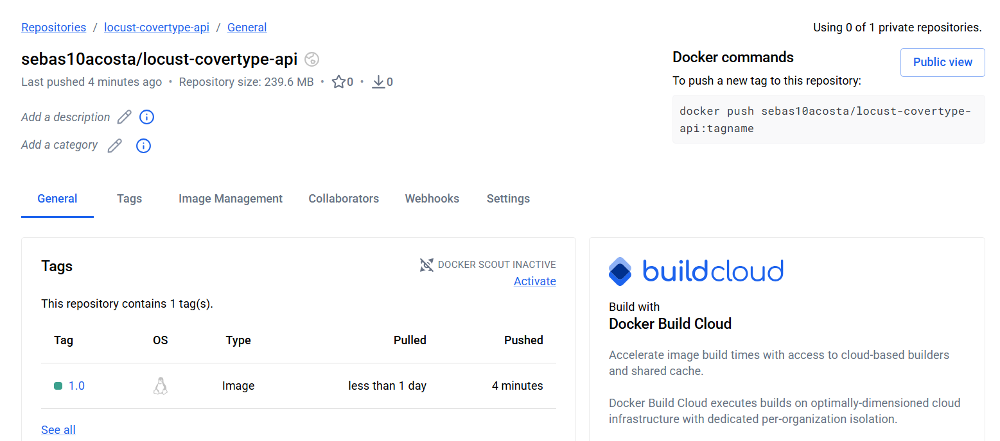

**La VM descarga la imagen publicada**

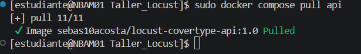

**Registro del modelo de 50 árboles con el alias `@loadtest`**

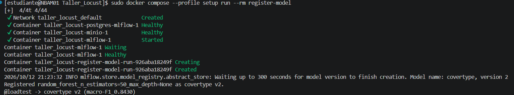

**Stack en la VM y modelo servido**

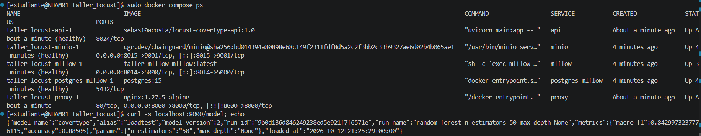

**Una réplica en reposo: ~500 MiB de un límite de 1 GiB**

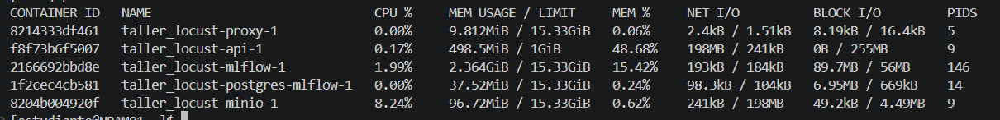

**1 réplica bajo carga: CPU al 100%, memoria estable**

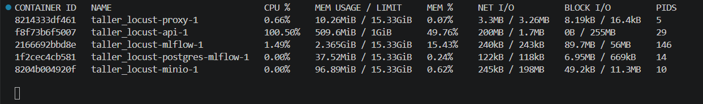

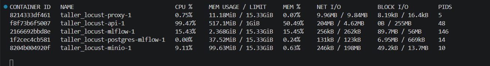

**Máquina generadora durante la prueba**

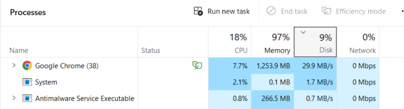

**Resultados de 1 réplica**

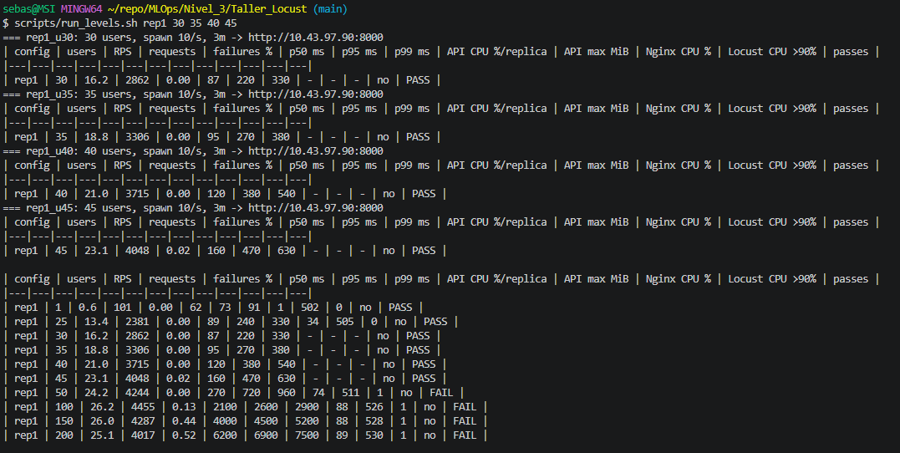

**3 réplicas bajo carga**

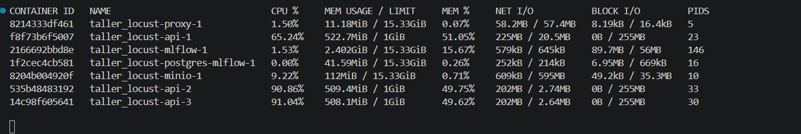

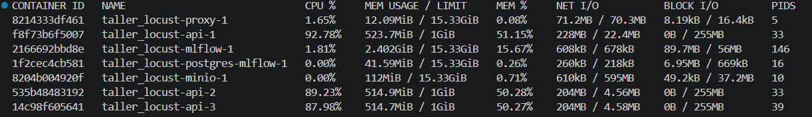

**Desbalance momentáneo del round robin**

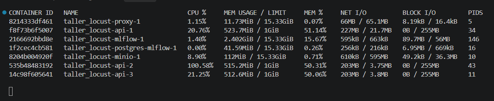

**`vmstat` durante 3 réplicas: sin *steal time* (st = 0), ~30% de CPU ociosa**

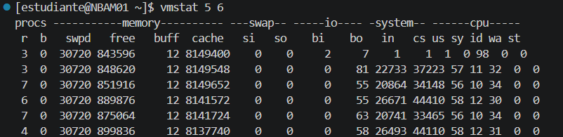

**Contadores de *throttling* antes y después de la prueba de 3 réplicas**

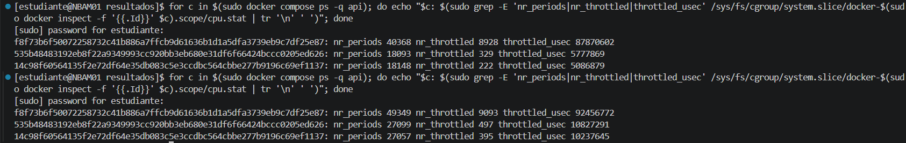

---

## 14. Estructura del repositorio

```text
Taller_Locust/
├── docker-compose.yaml          # VM: Nginx + API (Docker Hub) + MLflow, Postgres, MinIO
├── .env.example                 # credenciales (iguales al Taller MLflow) y límites por réplica
├── api/                         # código de la imagen publicada (copia del Taller MLflow)
├── nginx/nginx.conf             # balanceador
├── locust/                      # PC: locustfile, 100 filas reales, Dockerfile y compose
├── scripts/
│   ├── register_loadtest_model.py   # alias @loadtest -> RF 50 árboles
│   ├── run_levels.sh                # PC: un nivel tras otro
│   ├── record_stats.sh              # VM: docker stats -> CSV
│   └── summarize.py                 # tabla con PASS/FAIL
├── resultados/                  # CSV de Locust y de docker stats de la VM
└── images/                      # evidencias
```
